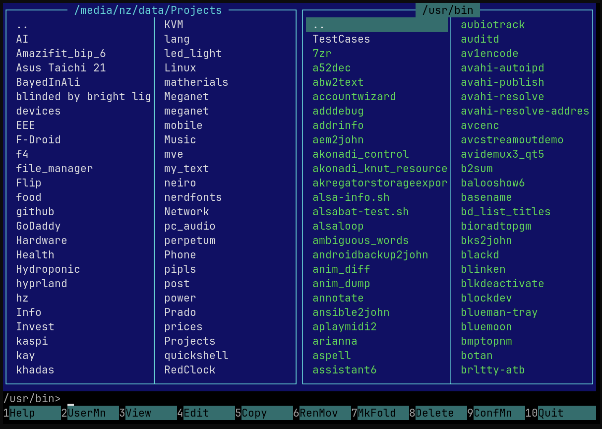

# xCommander (`xc`)

A fast, lightweight, FAR Manager-inspired dual-panel TUI file manager and text editor for Linux, written in C11 and `ncursesw`.

> **Note:** Built primarily for personal daily use on **Arch Linux** with **Kitty** as the primary terminal emulator (leveraging the Kitty Keyboard Protocol for dynamic `Ctrl`/`Alt`/`Shift` function key bars and full modifier support across EN/RU layouts), while remaining compatible with other modern Linux terminals (`xterm`, `konsole`, `xfce4-terminal`).



## Key Features

- **Dual-Panel File Management:** Full UTF-8 support, real-time `inotify` auto-refresh with debouncing (plus manual `Ctrl+R`), persistent panel state & symlink-aware logical navigation, full folder visit history (`Alt+F12` / `Ctrl+D`, `Alt+Backspace` / `Alt+Shift+Backspace` Back/Forward), sorting (`Ctrl+F3`–`Ctrl+F6`), quick prefix search (`Alt+<char>` with auto EN/RU layout), FAR-style mask & range selection (`+`, `-`, `*`, `Shift+Arrows`, `Alt+Shift+Home/End`), overwrite confirmation dialog (`F5`/`F6`/`Ctrl+V`), instant panel swap (`Ctrl+U`), and opening items in the system file manager (`Shift+Enter`).
- **Drive & Bookmarks Menu (`Alt+F1` / `Alt+F2`):** Instant jump to the opposite panel path (`-`), `$HOME` (`~`), `/`, mounted partitions (`/media`, `/run/media`, `/mnt`) with free space indicators, custom bookmarks (`Ins`/`+`, stored in `~/.config/xcommander/bookmarks`), and safe USB unmount (`F8` / `Delete` via `udisksctl`).
- **Built-in TUI Text Editor (`F4` / `Shift+F4` or `xc -e FILE`):**
  - Syntax highlighting (`C/C++`, `Python`, `Shell`, `Config`, `Generic`) with shebang (`#!/...`) detection, toggled via `F4`.
  - Matching bracket & quote highlighting, enclosing block jump (`Ctrl+]`), and block selection (`Alt+Shift+]`).
  - 64-step `Undo` / `Redo` (`Ctrl+Z` / `Ctrl+R`), search (`F7` / `Shift+F7`) and interactive FAR-style replace (`Ctrl+F7`) with **Case sensitive** and **POSIX RegExp** (`\t`, `\1`..`\9` capture groups) support, visible whitespace (`F5`), and auto-indent (`F9`).
- **Built-in Text & Hex Viewer (`F3`):** Line wrapping (`F2`), Hex dump mode (`F4`), binary character filtering, and search (`F7` / `Shift+F7`).
- **Terminal Mode (`Ctrl+O`) & Smart Clipboard:** Interactive shell execution loading `~/.bashrc` with custom Git-aware prompt (`~/.config/xcommander/prompt`), scrollable long command line, `text/uri-list` file copy/cut (`Ctrl+C` / `Ctrl+X`), and multiline script preview & runner (`Ctrl+V`) with deduplicated persistent history (`Alt+H`, editable via `F4`).
- **User Menu (`F2`) & Full Mouse Support:** Hierarchical user menus with hotkeys (`~/.config/xcommander/menu`), dynamic `F1`–`F10` modifier bar (`Ctrl`/`Alt`/`Shift`), and full mouse click/wheel support across all windows and dialogs.

## Command-Line Options

```bash
xc [OPTIONS] [LEFT_DIR] [RIGHT_DIR]
```

- `-e[LINE[:POS]] [FILE], --edit` — Open `FILE` directly in the built-in editor at `LINE:POS` (1-based) and exit upon closing.
- `-v, --version` — Print version and 6-digit build number.
- `-h, --help` — Show CLI usage help.

## Keyboard Shortcuts

### Panels, Viewer & Command Line

| Key | Action |
| --- | --- |
| `Tab` | Switch active panel (Left / Right) |
| `Enter` / `Ctrl+PgDn` | Open directory or run executable |
| `Shift+Enter` | Open directory or file in system file manager (`xdg-open`) |
| `Ctrl+PgUp` | Go to parent directory (`..`) |
| `Ctrl+U` | Swap left and right panels (preserving cursor) |
| `Ctrl+R` | Force reload both panels (auto-updates via `inotify`) |
| `Ctrl+F3` .. `Ctrl+F6` | Sort active panel by Name, Ext, Time, or Size (repeat to reverse) |
| `Alt+F1` / `Alt+F2` | Open Drive & Bookmarks menu for Left / Right panel (`Ins`/`+` add, `F8`/`Del` remove/unmount) |
| `Insert` / `Shift+Arrows` | Mark or unmark files & column ranges (auto-clears after copy) |

| `Alt+F12` / `Ctrl+D` | Open Folder History (512 steps; filter, Go, Other panel, Insert path) |
| `Alt+Backspace` / `Alt+Shift+Backspace` | Step Back / Forward through visited folder history |
| `Alt+Shift+Home` / `End` | Add range from cursor to start / end of directory to selection |
| `+` / `-` / `*` | Select by wildcard mask / Deselect by mask / Invert selection |
| `Alt+<char>` | Quick prefix search (auto EN/RU layout; `Esc` to cancel) |
| `F1` / `F2` | Open Help / Hierarchical User Menu |
| `F3` / `F4` / `Shift+F4` | Built-in Viewer / Built-in Editor / Create & edit new file |
| `F5` / `F6` / `F7` / `F8` | Copy (with overwrite prompt) / Move or rename / Make folder / Delete |
| `Alt+[` / `Alt+]` | Insert Left / Right panel path into command line |
| `Alt+Enter` / `Ctrl+J` | Insert current filename into command line |
| `Ctrl+C` / `Ctrl+X` / `Ctrl+V` | Copy / Cut / Paste files (`text/uri-list`), text, or multiline script |
| `Alt+H` | Open Multiline Command History (`Enter` run, `F4` edit, `F8`/`Del` remove) |
| `Alt+F8` / `Ctrl+H` | Open Command History (512 items with timestamp & dir; type to filter command; Run / Insert / Jump to dir / Delete) |
| `Ctrl+E` / `Ctrl+X` | Step through persistent command line history inline |
| `Ctrl+O` | Toggle full terminal mode / panels |
| `F10` / `Ctrl+Q` | Save panel paths & history and quit |

### Built-in Editor (`F4`)

| Key | Action |
| --- | --- |
| `Arrows` / `Ctrl+Left/Right` | Move by character or jump by word |
| `Home` / `End` / `Ctrl+Home/End` | Jump to line start/end or file start/end |
| `Ctrl+]` / `Alt+Shift+]` | Jump to matching bracket/quote or select enclosing block |
| `F3` / `Shift+Arrows` / `Ctrl+A` | Toggle block mark / select text / select entire file |
| `Ctrl+C` / `F6` (`Ctrl+X`) / `Ctrl+V` | Copy / Cut / Paste block |
| `Ctrl+Z` / `Ctrl+R` / `Ctrl+Y` | Undo / Redo / Delete current line |
| `F2` / `F4` / `F5` / `F9` | Save / Toggle syntax / Toggle whitespace / Toggle auto-indent |
| `F7` / `Shift+F7` / `Ctrl+F7` | Find / Find next / Interactive Replace (`Case sensitive`, `RegExp`, `\t`, `\1`..`\9`) |
| `F1` / `Esc` (`F10`, `Ctrl+Q`) | Editor Help / Exit editor (prompts to save if modified) |

## Build & Install

```bash
make
sudo make install
```

## License

This project is licensed under the **BSD 3-Clause License** — see the [LICENSE](LICENSE) file for details.
