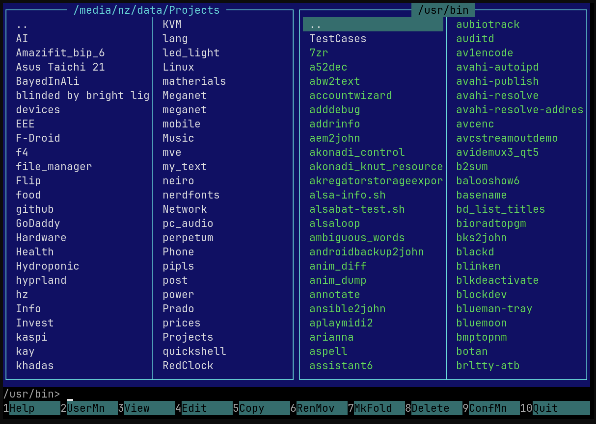

# xCommander (`xc`)

[English](README.md) | **Русский**

Быстрый и лёгкий двухпанельный консольный файловый менеджер для Linux в духе FAR Manager и Midnight Commander, написанный на чистом C с использованием `ncurses`. Разрабатывается, тестируется и используется ежедневно на **Arch Linux** в терминале **Kitty**.



## Основные возможности

- **Динамические панели и встроенное повышение привилегий (`sudo`)**: неограниченное число файлов в каталоге благодаря динамическому выделению памяти (`malloc`/`realloc`), а также автоматический запрос пароля (красное окно `Operation requires privileges elevation` с кэшированием на сессию) при нехватке прав (`EACCES`/`EPERM`) при сохранении в редакторе (`F4` -> `F2`), копировании/переносе (`F5`/`F6`), создании папок (`F7`), удалении (`F8`/`Shift+F8`), создании ссылок (`Alt+F6`) и смене атрибутов (`Ctrl+A`).
- **Панель детальной информации в стиле FAR (`Ctrl+I`)**: путь, тип/симлинк/ветка Git, безлимитный рекурсивный подсчёт размера и числа файлов/папок (с живым окном `Scanning the folder` и прерыванием по `Esc`), права, владелец, время и статистика диска/точки монтирования.
- **Динамические панели и встроенное повышение привилегий (`sudo`)**: неограниченное число файлов в каталоге благодаря динамическому выделению памяти (`malloc`/`realloc`), а также автоматический запрос пароля (красное окно `Operation requires privileges elevation` с кэшированием на сессию) при нехватке прав (`EACCES`/`EPERM`) при сохранении в редакторе (`F4` -> `F2`), копировании/переносе (`F5`/`F6`), создании папок (`F7`), удалении (`F8`/`Shift+F8`), создании ссылок (`Alt+F6`) и смене атрибутов (`Ctrl+A`).
- **Панель детальной информации в стиле FAR (`Ctrl+I`)**: путь, тип/симлинк/ветка Git, безлимитный рекурсивный подсчёт размера и числа файлов/папок (с живым окном `Scanning the folder` и прерыванием по `Esc`), права, владелец, время и статистика диска/точки монтирования.
- **Двухпанельная навигация и автообновление**: мгновенная работа с каталогами, отслеживание изменений через `inotify`, сортировка (`Ctrl+F3`..`Ctrl+F6` с индикатором в левом углу рамки), меню дисков и закладок (`Alt+F1` / `Alt+F2`) с безопасным извлечением USB-накопителей и отключаемая 32-цветная автораскраска файлов по расширениям (`Alt+F12`).
- **Поиск файлов по маске и содержимому (`Alt+F7`)**: быстрый рекурсивный поиск с поддержкой нескольких масок (`*.c;*.h`), поиском текста внутри файлов с указанием номера строки и быстрыми действиями (`Enter` перейти к файлу, `F3` просмотр, `F4` редактировать на найденной строке, `Ctrl+J` вставить путь).
- **Виртуальная темп-панель в стиле FAR (`TmpPanel`)**: панель-коллектор (`Alt+F1` / `Alt+F2` -> `0` или кнопка `[ Panel ]` в результатах поиска `Alt+F7`) для сбора ссылок на разрозненные файлы и каталоги без копирования на диск; добавление по `F5`, удаление из списка по `F8`, переход к реальному файлу по `Ctrl+PgUp`.
- **Виртуальная работа с архивами (VFS)**: вход в архив как в обычную папку (`Enter` или `Ctrl+PgDn` для `.zip`, `.jar`, `.apk`, `.whl`, `.epub`, `.docx`, `.tar`, `.tgz`, `.tar.gz`, `.tar.xz`, `.tar.bz2`, `.tar.zst`, `.7z`, `.rar`), просмотр (`F3`), редактирование с автообновлением в архиве (`F4`), распаковка (`F5`), удаление внутри архива (`F8`) и упаковка файлов (`Shift+F1` / `Alt+F5`).
- **Встроенные просмотрщик и TUI-редактор**: просмотрщик текста и Hex (`F3`) и текстовый редактор (`F4` / `Shift+F4`) с подсветкой синтаксиса, сохранением под новым именем (`Shift+F2` Save As), запоминанием позиции курсора для каждого файла, дублированием строк и блоков (`Ctrl+Shift+D`), перемещением строк вверх/вниз (`Ctrl+Shift+Up/Down`), комментированием (`Ctrl+/`), умным автоотступом (`Enter`), сдвигом блоков (`Tab` / `Shift+Tab`) копированием/вырезанием текущей строки без выделения (`Ctrl+C` / `Ctrl+X`) и сохраняемыми клавиатурными макросами в стиле FAR (`Ctrl+.` запись/стоп и привязка к любой клавише, `Ctrl+M` просмотр, запуск и удаление).
- **4 журнала постоянной истории и динамическая 12-кнопочная F-панель**:
  - `Alt+F8` / `Ctrl+H`: История однострочных команд (512 записей с датой и каталогом; живой фильтр, запуск / вставка / переход в папку / удаление)
  - `Alt+F9`: История открытых и отредактированных файлов (512 записей с позицией курсора; редактирование / просмотр / переход / удаление)
  - `Alt+F10` / `Ctrl+D`: История посещённых каталогов (512 шагов; живой фильтр, переход / соседняя панель / вставка пути / удаление; а также `Alt+Backspace` / `Alt+Shift+Backspace` Назад/Вперёд)
  - `Alt+F11` / `Ctrl+L`: История многострочных скриптов (запуск / редактирование во встроенном редакторе / удаление)
  - Удержание `Alt` / `Ctrl` / `Shift` динамически переключает нижнюю панель из 12 функциональных клавиш.
- **Живое автодополнение из истории и вывод команд в редактор `F4`**: при вводе в командной строке с 1-го символа появляется компактное окно подсказок по началу команды (`Up`/`Down` выбор, `Right`/клик подстановка, `Esc` скрыть); нажатие `Shift+Enter` выполняет команду и сразу открывает её вывод во встроенном редакторе `F4`.
- **Окна прогресса со скоростью, ETA и подтверждением отмены**: живой прогресс-бар (`F5` копирование, `F6` перенос, `F8` корзина, `Shift+F8` удаление) со скоростью `МБ/с`, оставшимся временем (`ETA`) и безопасной отменой по `Esc`.
- **Умный буфер обмена и нативная прокрутка терминала**: копирование/вставка файлов (`URI-list`) и текста (`Ctrl+C` / `Ctrl+X` / `Ctrl+V`), окно подтверждения при вставке многострочных скриптов, быстрый поиск по префиксу (`Alt+<символ>` с автоопределением EN/RU раскладки), живой фильтр в справке (`F1`) и полноэкранный терминал (`Ctrl+O`) с автоматическим освобождением мыши для прокрутки колёсиком и выделения текста.

## Сборка и запуск

```bash
make
./xc
```

### Параметры командной строки

- `xc` — запуск двухпанельного файлового менеджера в текущем каталоге
- `xc -e [СТРОКА[:ПОЗИЦИЯ]] [ФАЙЛ]` / `--edit` — открыть файл (или `-` для `stdin`) напрямую во встроенном редакторе
- `xc -v [СТРОКА] [ФАЙЛ]` / `--view` — открыть файл (или `-` для `stdin`) напрямую во встроенном просмотрщике
- `xc -V` / `--version` — показать версию и номер сборки
- `xc -h` / `--help` — справка по аргументам запуска

## Горячие клавиши

| Клавиша | Действие |
| :--- | :--- |
| `Tab` | Переключение активной панели (Левая / Правая) |
| `Enter` | Открыть каталог, войти в архив или запустить исполняемый файл |
| `Ctrl+PgUp` / `Ctrl+PgDn` | Перейти на уровень вверх (`..`) / войти в каталог или любой архив |
| `Ctrl+U` | Поменять левую и правую панели местами с сохранением курсора |
| `Ctrl+R` | Принудительно обновить обе панели |
| `Ctrl+F3`..`Ctrl+F6` | Сортировка активной панели: Имя, Расширение, Время, Размер (повтор — реверс) |
| `Alt+F1` / `Alt+F2` | Меню дисков, закладок и `TmpPanel` (`0`) для левой / правой панели (`Ins`/`+`, `F8`/`Del`) |
| `Insert` / `Shift+Стрелки` | Выделить / снять выделение с файлов, диапазонов или слов в редакторе |
| `+` / `-` / `*` | Выделить по маске / Снять выделение по маске / Инвертировать выделение |
| `Alt+<символ>` | Быстрый поиск по началу имени (автоопределение EN/RU раскладки) |
| `F1` | Открыть справку с живым поиском-фильтром |
| `F2` / `F9` | Меню пользователя (`~/.config/xcommander/menu`) / Верхнее меню (`F9`) |
| `F3` | Встроенный просмотрщик Text / Hex (`F2` перенос строк, `F4` Hex, `F7` поиск) |
| `F4` / `Shift+F4` | Редактировать файл (восстанавливает позицию курсора) / Создать новый файл (`Shift+F2`: Save As в редакторе) |
| `Ctrl+Shift+D` / `Ctrl+/` | Дублировать строку/блок / Закомментировать или раскомментировать в редакторе |
| `Ctrl+Shift+Up` / `Down` | Переместить текущую строку или выделенный блок вверх / вниз в редакторе |
| `Tab` / `Shift+Tab` | Увеличить / уменьшить отступ выделенного блока (или строки) в редакторе |
| `Ctrl+.` / `Ctrl+M` | Записать/остановить макрос (назначить клавишу) / Менеджер макросов в редакторе |
| `Ctrl+O` (в редакторе) | Показать экран терминала с прошлым выводом команд (как в FAR) |
| `Alt+F8` (в редакторе) | Диалог перехода к строке (или `строка:колонка`) |
| `F5` / `F6` | Копировать (или извлечь из архива) / Переместить или переименовать (понимает относительные пути) |
| `Alt+F6` | Создать символическую (`ln -s`) или жёсткую (`ln`) ссылку (с поддержкой `sudo`) |
| `Shift+F5` / `Shift+F6` | Копировать / Переименовать одиночный файл на месте (подставляет только имя; для группы — как обычно) |
| `Shift+F1` / `Alt+F5` | Упаковать выделенные файлы в архив (`.zip`, `.tar.gz`, `.tar.xz`, `.tar.zst`, `.7z`) |
| `F7` / `F8` / `Shift+F8` | Создать каталог / В системную корзину (или удалить в архиве) / Удалить безвозвратно |
| `Ctrl+A` | Диалог прав, владельца, группы и времени (`chmod`, `chown`, `mtime`/`atime`, рекурсия) |
| `Ctrl+G` | Применить команду ко всем выделенным элементам (макросы FAR `!.!`, `!~`, `!.`, `!:`, `!/`, автосохранение команды) |
| `Ctrl+I` | Панель детальной информации в стиле FAR (рекурсивный расчёт каталогов с отменой по `Esc`, права, диск) |
| `Alt+F7` | Поиск файлов по маске и тексту (`Enter` Перейти, `F3` Просмотр, `F4` Редактировать на строке, `Ctrl+J` Вставить) |
| `Alt+F8` / `Ctrl+H` | История однострочных команд (фильтр, Запуск / Вставка / Переход / Удаление) |
| `Alt+F9` | История файлов с позицией курсора (Редактировать / Просмотр / Переход / Удаление) |
| `Alt+F10` / `Ctrl+D` | История посещённых каталогов (фильтр, Переход / Соседняя панель / Вставка / Удаление) |
| `Alt+F11` / `Ctrl+L` | История многострочных скриптов (Запуск / Редактирование / Удаление) |
| `Alt+F12` | Включить / выключить 32-цветную автораскраску файлов по расширениям |
| `Alt+Backspace` / `Alt+Shift+Backspace` | Шаг Назад / Вперёд по истории посещённых каталогов |
| `Alt+[` / `Alt+]` | Вставить путь левой / правой панели в командную строку |
| `Ctrl+Enter` / `Alt+Enter` / `Ctrl+J` | Вставить имя файла под курсором в командную строку (автоподстановка `./` для исполняемых файлов в пустой строке) |
| `Shift+Enter` | Выполнить команду и открыть её вывод сразу в редакторе `F4` (при непустой строке) |
| `Up` / `Down` / `Right` (в строке) | Выбор и подстановка подсказки из истории команд (`Esc` скрывает окно) |
| `Ctrl+C` / `Ctrl+X` / `Ctrl+V` | Умное копирование / вырезание / вставка (файлы, выделение или целая строка в редакторе) |
| `Alt+Shift+N` | Скопировать имя файла под курсором или имена выделенных файлов как текст в буфер обмена |
| `Ctrl+O` | Переключение между панелями и терминалом (с нативной прокруткой колёсиком и выделением мышью) |
| `F10` / `Ctrl+Q` | Сохранить состояние и журналы истории и выйти |
